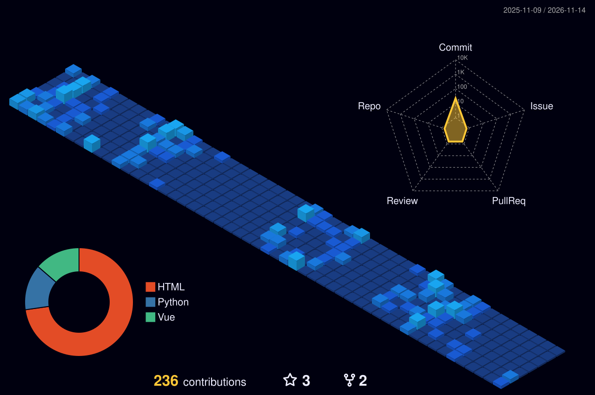

  

  

  

  

  

  

## 🍥 S-Rank Missions &amp; Demon Moon Hunts 🗡️

<table>
<thead>
<tr>
  <th align="left" width="24%">Mission / Scroll</th>
  <th align="left" width="46%">Objective &amp; Architecture</th>
  <th align="left" width="20%">Jutsu / Technique</th>
  <th align="center" width="10%">Rank</th>
</tr>
</thead>
<tbody>
<tr>
  <td><a href="https://github.com/mangekyoflow/nestjs-microservices"><b>NestJS Microservices</b></a></td>
  <td>Enterprise distributed RESTful microservices with Nx monorepo, Docker containers, and automated Swagger contracts.</td>
  <td><code>TypeScript</code> <code>NestJS</code> <code>Docker</code> <code>Nx</code></td>
  <td align="center">⚡&nbsp;<b>S-Rank</b></td>
</tr>
<tr>
  <td><a href="https://github.com/mangekyoflow/nestjs-starter"><b>NestJS Production Starter</b></a></td>
  <td>Battle-hardened enterprise scaffold bundling NestJS, PostgreSQL relational storage, Redis caching, and Docker.</td>
  <td><code>NestJS</code> <code>PostgreSQL</code> <code>Redis</code> <code>Docker</code></td>
  <td align="center">📜&nbsp;<b>A-Rank</b></td>
</tr>
<tr>
  <td><a href="https://github.com/mangekyoflow/mangekyoflow.github.io"><b>Mangekyō Dimension Hub</b></a></td>
  <td>Personal digital sanctum and cloud-hosted interactive engineering portfolio space.</td>
  <td><code>HTML5</code> <code>CSS3</code> <code>JavaScript</code></td>
  <td align="center">👁️&nbsp;<b>Kamui</b></td>
</tr>
</tbody>
</table>

  

<a href="https://github.com/mangekyoflow?tab=repositories"><b>→ Explore all 216+ Shinobi Scrolls &amp; Open Source Repositories</b></a>

  

  

  

  

  

  

  

**“心を燃やせ - Set your heart ablaze, and never compromise your code.”** 🍥 🔥 👁️

